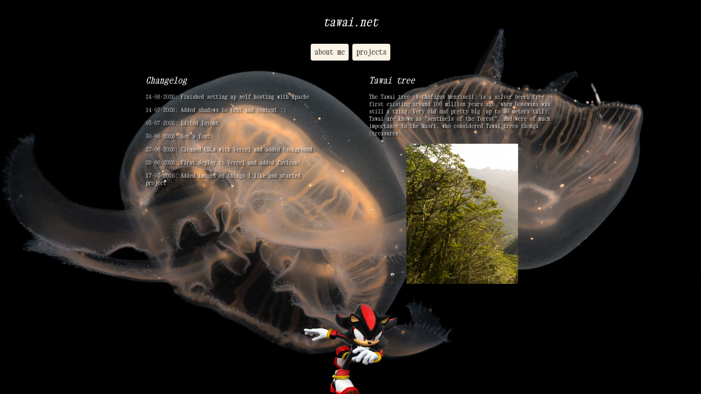

# tawai.net

My personal website: hand-written HTML and CSS with no frameworks or build step, **self-hosted on Apache** from my own machine, with an automated dynamic-DNS script so the domain keeps pointing at my home connection.


**Live site:** [tawai.net](https://tawai.net)



## About the project

The site started as a place to showcase my programming projects and has grown into a general home on the web. It is named after the Tawai (my middle name) tree (*Nothofagus menziesii*), a silver beech.

I deliberately built it by hand to understand the full path from files to a working site: writing the markup and styles, configuring a web server, routing clean URLs, and keeping a DNS record current on a residential IP address.

## Pages

| Page | Description |
|---|---|
| **Home** (`index.html`) | Site changelog, a short piece on the Tawai tree, and an embedded guestbook |
| **About me** (`pages/aboutme.html`) | Who I am, what I study, and what I play in my band |
| **Projects** (`pages/projects.html`) | Write-ups with screenshots of my graphics work: an OpenGL PBR renderer and a procedural terrain generator |
| **Media** (`pages/media.html`) | Placeholder page, not linked from the navigation yet |

## Technical highlights

- **No dependencies.** Plain HTML and a single 109-line stylesheet (`css/main.css`), with self-hosted fonts and modern image formats (AVIF and WebP) for the heavier assets.
- **Self-hosted on Apache.** The site migrated from a managed Vercel deployment to my own server, which gave me hands-on experience with web-server configuration and deployment.
- **Clean URLs via `mod_rewrite`.** `.htaccess` maps extensionless paths like `/aboutme` to `pages/aboutme.html`, but only when the request doesn't match a real file or directory, so static assets are served normally.
- **Dynamic DNS automation** (`updatedns.sh`). A Bash script uses `curl` and `jq` to compare my current public IP with the Cloudflare DNS record and update it through the Cloudflare API only when it has changed.
- **Secrets kept out of the repo.** API credentials live in a git-ignored `.env` file that the script loads at runtime.
- **One-command deploy** (`reloadserver.sh`). Detects macOS (Homebrew Apache) or Linux and copies the site into the right web root, excluding the maintenance scripts, todo, and README.

## Repository structure

```
.
├── index.html            Home page
├── pages/                aboutme, projects
├── css/main.css          Site-wide styles
├── fonts/                Xanh Mono and Libertinus Mono (self-hosted)
├── resources/            Images, background, project screenshots
├── scripts/              Bash scripts used to test locally or update dns records
├── .htaccess             Clean-URL rewrite rules
└── todo.txt              Planned features and layout sketch
```

## Running it yourself

### Preview locally

Because clean URLs depend on Apache's `mod_rewrite`, the easiest faithful preview is Apache itself (see below). For a quick look at the home page without Apache:

```bash
python3 -m http.server 8000
# open http://localhost:8000
```

Note that with a plain static server, links like `/aboutme` won't resolve; open `/pages/aboutme.html` directly instead.

### Deploy with Apache

1. Install Apache and enable `mod_rewrite`, with `AllowOverride All` for the web root so `.htaccess` is honoured.
2. Run the deploy script from the repository root:

   ```bash
   ./reloadserver.sh
   ```

   It copies the site to `/opt/homebrew/var/www` on macOS or `/srv/http` on Linux. **It empties the destination directory first**, so only point it at a web root dedicated to this site.

### Keep DNS in sync (optional)

`updatedns.sh` needs `curl` and `jq`, plus a `.env` file in the project directory (never commit this file):

```bash
CLOUDFLARE_API_TOKEN=...
ZONE_ID=...
DNS_RECORD_ID=...
DNS_RECORD_TYPE=A
DNS_RECORD_NAME=your.domain.example
```

Run it on a schedule (for example with `cron`) so the record follows your IP address. The script path to `.env` is currently hardcoded near the top of the file; adjust it for your setup.

## Roadmap

Ideas I'm planning to add are tracked in [`todo.txt`](todo.txt), including a music player, animated favicon, cursor trail, a random-page link and optional retro dithering effects.

## Related projects

- [LearnOpenGL](https://github.com/tikitaik/LearnOpenGL): a C++ / OpenGL 3.3 renderer with PBR and image-based lighting, featured on the Projects page.
- [terrain generator](https://github.com/tikitaik/terrain-gen): also a C++ / OpenGL 3.3 renderer, aimed at creating terrain using many algorithms and optimisations (in progress).

## Credits

- Fonts: [Xanh Mono](https://fonts.google.com/specimen/Xanh+Mono) and [Libertinus Mono](https://github.com/alerque/libertinus), each under its own open-source licence
- Guestbook embedded from [Atabook](https://atabook.org). Third-party images and GIFs belong to their respective owners.

## Contact

**Edward Hirst** · [Portfolio](https://tawai.net/projects) · [LinkedIn](https://linkedin.com/in/ed-hirst) · [edthirst@gmail.com](mailto:edthirst@gmail.com)

